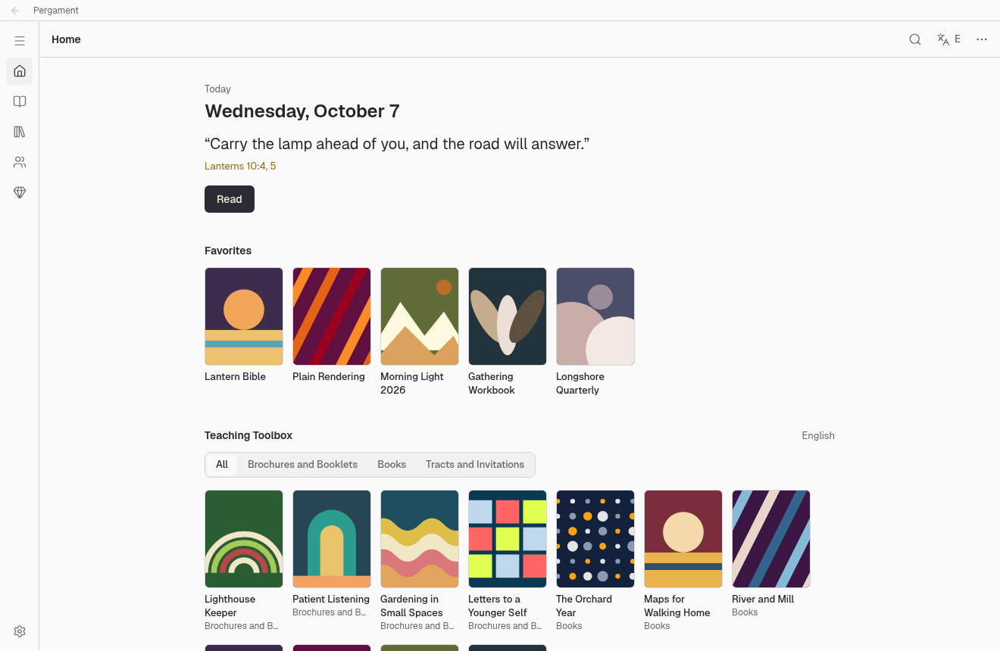
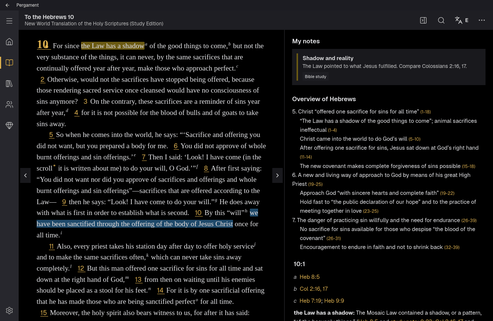
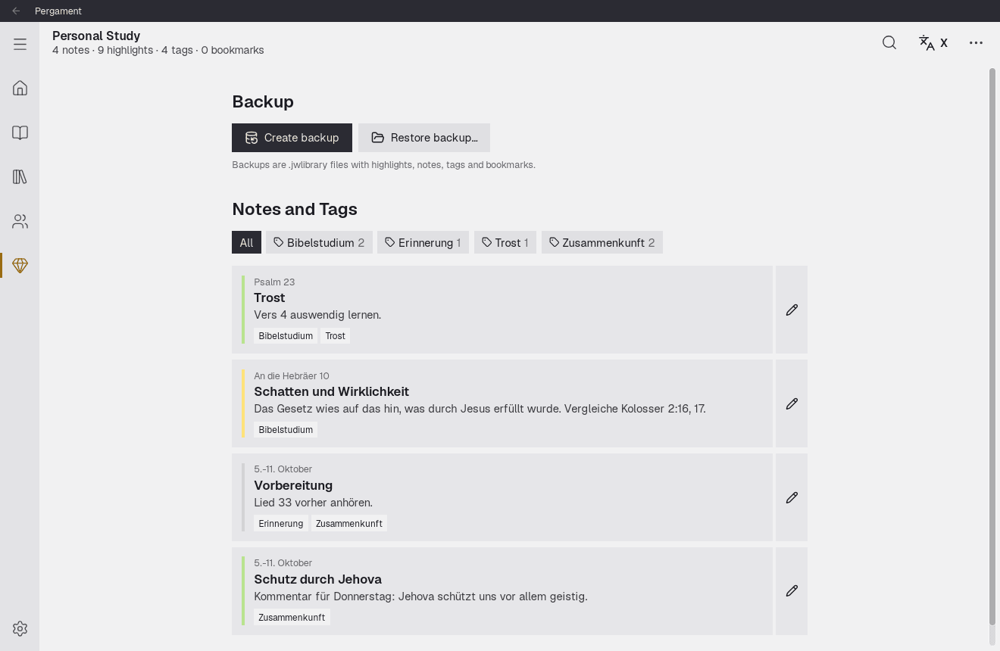

# Pergament

A quiet reader for `.jwpub` publications, with native Linux and portable
Windows builds. It has today's text, the
Bible with a study pane, your library, the meeting material, and your notes and
highlights. There is also an untested build for Apple Silicon Macs.

Pergament is unofficial. Read [Before you use it](#before-you-use-it) first.



| | |
|---|---|
|  |  |

More in [docs/screenshots](docs/screenshots). All content shown is invented.

## Features

- **Home:** today's text, favorites, the Teaching Toolbox and What's New. The
  last two each have their own language. Favorites include all languages in
  their saved order and are kept in `userData.db`, with backups and sync.
- **Bible:** book tiles, chapter grid and book overviews. `Ctrl+G` goes to a
  reference such as `Heb 10:24`, and the arrow keys turn chapters. The study
  pane has the outline, footnotes, cross references, study notes and Research
  Guide. Bible links open the verses in all your translations side by side.
- **Library:** the catalog's publications, video and audio, what you have
  downloaded, and updates. Recordings play in a built-in player with quality,
  speed and subtitles.
- **Meetings:** the week's workbook program and Watchtower study article.
- **Personal Study:** highlights in six colors, Markdown notes with tags, and
  bookmarks, all searchable. Notes can move to their own window. There,
  `Ctrl+L` links a Bible reference and `Ctrl+P` also opens it.
- **Backups:** `.jwlibrary` files, the same format JW Library uses. Restore
  one, or merge it with your data. Pergament also writes a rolling backup to
  the `backups` folder in the library folder when you close it and once a day,
  and keeps the newest ones.
- **Settings:** English, German, Portuguese (Brazil) or French; light or dark; a
  centered or full-width layout; an easy-to-read font; and a second display for
  the year text, recordings and pictures.

## Install

Releases are on the [releases page](https://github.com/v3rm1n0/pergament/releases).
Check every download against the SHA-256 digest shown next to it before
installing it.

**Windows (x86_64):** extract the portable zip and run `pergament-app.exe`.
The [WebView2 Runtime](https://developer.microsoft.com/microsoft-edge/webview2/)
is required; it is already installed on most Windows systems.

**Linux packages** (x86_64):

```sh
sudo apt install ./Pergament-X.Y.Z-linux-x86_64.deb    # Debian, Ubuntu
sudo dnf install ./Pergament-X.Y.Z-linux-x86_64.rpm     # Fedora
./Pergament-X.Y.Z-x86_64.AppImage
flatpak install --user Pergament-X.Y.Z-linux-x86_64.flatpak
```

Installing the `.deb` also adds the Pergament apt repository
(`https://v3rm1n0.github.io/pergament/apt/`), so later versions arrive with the
normal system update. The repository is signed with the key
`71162C8E5F5EFABAA6ECB400A8001EBD72C3A8BF`. `sudo apt remove pergament` removes
the repository again; so does `apt purge`.

To add the repository first and install from it instead:

```sh
sudo install -d -m 0755 /etc/apt/keyrings
sudo curl -fsSLo /etc/apt/keyrings/pergament.gpg \
  https://raw.githubusercontent.com/v3rm1n0/pergament/main/packaging/apt/pergament.gpg
gpg --show-keys /etc/apt/keyrings/pergament.gpg   # check the fingerprint above
sudo tee /etc/apt/sources.list.d/pergament.sources > /dev/null <<'EOF'
Types: deb
URIs: https://v3rm1n0.github.io/pergament/apt/
Suites: ./
Signed-By: /etc/apt/keyrings/pergament.gpg
EOF
sudo apt update && sudo apt install pergament
```

These are the same two files the package installs, so the package takes them
over and removing it removes the repository as well.

**Linux zip:** unpack it and run `./install.sh`. It needs WebKitGTK 4.1, GTK 3,
libsoup 3, OpenSSL and SQLite. Video needs `gst-libav` (`gstreamer1-libav` on
Fedora); the packages above already include it.

**Mac (Apple Silicon):** open the `.dmg` and drag Pergament to Applications.
The app isn't signed, so the first time, right-click it and choose Open.

**Nix:** `nix profile install github:v3rm1n0/pergament`

**From source:** clone the repository and run `scripts/install.sh`. It uses Nix
if you have it, and otherwise builds with cargo and bun. Run it with
`--dry-run` to see what it would do.

## Sync between computers

Settings > Library & data > "Automatic backups and sync" can keep several
computers in step. Choose a folder that Nextcloud, Syncthing, Dropbox or
another sync app already keeps in sync. Each computer writes its own file
there, merges the files of the others when they change, and deletions carry
over. Pergament only reads and writes that folder; the sync app moves the
files.

- If another computer's file would delete a lot of your items, nothing is
  deleted yet. Pergament asks first: "Apply deletions" or "Keep my data".
  "Keep my data" protects only this computer. To get the items back on the
  other one, restore a backup there.
- An edit always wins over a deletion. When two computers changed the same
  item differently, both end up with the same version. "Show conflicts" lists
  these cases.
- If this computer's data is lost or reset while sync stays on, it counts as
  a new computer and gets everything back from the others.
- Restoring a backup, or applying deletions, writes a backup of the data
  first, even with automatic backups turned off. Restoring also changes the
  data on the other synced computers, and the restore dialog says so.
- "Stop syncing" leaves the folder as it is and keeps your data. If you
  start again later, this computer's data is merged back as new: deletions
  made on other computers in the meantime aren't applied here.

## Command line

```sh
pergament import file.jwpub                       # add to the library
pergament list                                    # imported publications
pergament show nwtsty 19:23 > psalm23.html        # a Bible chapter as HTML
pergament search X wachtturm                      # search the catalog
pergament download wp --lang X --issue 20260900   # download and import
```

The library is in `~/.local/share/pergament`. You can change it with
`--library` or `PERGAMENT_LIBRARY`.

## Before you use it

Pergament is not affiliated with or endorsed by Jehovah's Witnesses or the
Watch Tower Bible and Tract Society. "JW Library" is their trademark.

- **Your own publications only.** The repository contains none.
- **Clean-room.** Nothing was decompiled. The file format is documented in
  [docs/FORMAT.md](docs/FORMAT.md).
- **Encryption.** Pergament decrypts the text in `.jwpub` files. Depending on
  where you live, sharing software that does this may be restricted.
- **Free, non-commercial, no telemetry.** It only connects to jw.org's public
  catalog and download services, and only when you ask it to.

## Contributing

Pull requests and translations are welcome. See [CONTRIBUTING.md](CONTRIBUTING.md)
and [docs/TRANSLATING.md](docs/TRANSLATING.md).

## License

GPL-3.0-only, see [LICENSE](LICENSE). The fonts are under the SIL Open Font
License 1.1.

The project has no permission from the rights holders. Its use is tolerated at
most, which can change at any time. Use it at your own risk: it comes without
warranty, and you are responsible for checking that your use is lawful where
you live. The only official builds are the ones on the GitHub releases page.
